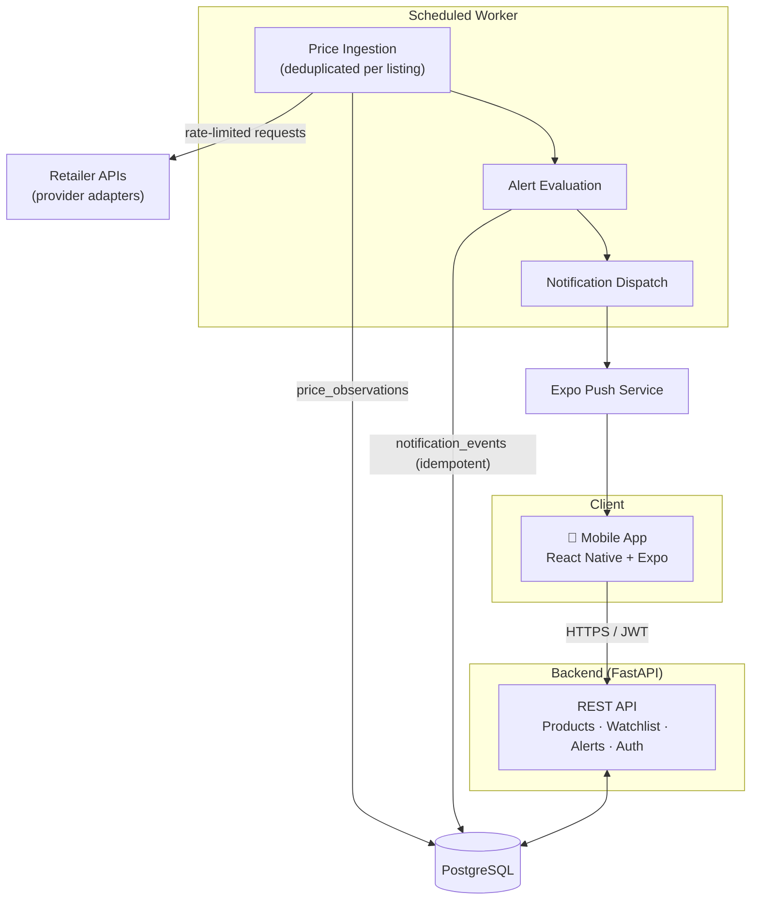
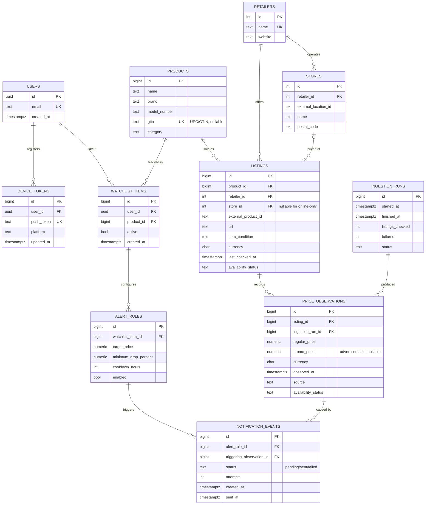

# Tagvello

**Find it once. Track it automatically. Buy it when the price is right.**

Tagvello is a cross-platform mobile app that tracks the products you want, records their real prices across stores over time, and notifies you when a price crosses a threshold you set. Its goal is to answer one question with data instead of marketing:

> **"Is this actually a good deal, and is now the right time to buy it?"**


> 🚧 **Project status:** Planning / pre-development. This README describes the target design; sections will be updated as each milestone ships. Progress is tracked in [`PROJECT_LOG.md`](PROJECT_LOG.md).

---

## Table of Contents

- [Why Tagvello](#why-tagvello)
- [MVP Features](#mvp-features)
- [Architecture](#architecture)
- [Data Model](#data-model)
- [Data Sources](#data-sources)
- [Tech Stack](#tech-stack)
- [Engineering Highlights](#engineering-highlights)
- [Repository Structure](#repository-structure)
- [Roadmap](#roadmap)
- [Getting Started](#getting-started)
- [Known Limitations](#known-limitations)
- [Project Log](#project-log)

---

## Why Tagvello

Shoppers constantly re-check websites, forget items they meant to buy, miss short-lived sales, and can't tell whether a "30% off" tag is real. Tools like Google Shopping, Keepa, and Honey each solve part of this. Tagvello combines **personal watchlists**, **independently observed price history**, **custom alerts**, and **cross-store comparison** in one place.

Design principles:

- **Real data only.** Every price shown is an actual timestamped observation. Simulated data is used only for clearly labeled tests and demos.
- **Observed vs. advertised.** Tagvello tells apart a retailer's *advertised* promotion and a price drop it *observed* itself.
- **Honest freshness.** Every price shows when it was last verified. Stale or unavailable data is labeled as such.
- **Low effort.** After a product is saved, monitoring happens in the background without the app open.

## MVP Features

| # | Feature | Description |
|---|---|---|
| 1 | **Product search** | Search a supported retailer's catalog by keyword; see name, brand, image, store, current price, and last-checked time. |
| 2 | **Watchlist** | Save, remove, and browse tracked products; persists across sessions. |
| 3 | **Price history** | A scheduled worker records a price observation for every tracked listing, even when the price hasn't changed. |
| 4 | **History charts & stats** | Latest, lowest, highest, and average observed price, plus % change over a chosen period, all computed in SQL from real observations. |
| 5 | **Price alerts** | Notify when a price drops below a target amount or by a minimum percentage, with cooldowns and duplicate prevention. |
| 6 | **Store comparison** | Compare the same product's price across nearby store locations. |
| 7 | **Push notifications** | Expo push notifications that deep-link to the product page, with an in-app notification feed as a fallback. |

**Core screens:** Search · Watchlist · Product Details · Alert Settings · Settings

**Post-MVP:** deal-quality scoring ("lowest price in 30 days"), multi-retailer comparison, URL/share-sheet import, barcode scanning, AI-assisted product matching, and shopping-basket optimization.

## Architecture

A straightforward client–server design. The mobile app never holds retailer credentials, and the backend owns all retrieval, price processing, alert evaluation, and authorization. Ingestion runs on a schedule, separate from user-facing requests.



**Provider adapter pattern.** Each data source implements one interface (`search()`, `get_price(listing)`, `rate_limit`), so adding a retailer means adding an adapter. The core system doesn't change.

## Data Model

The schema is normalized around one key split: a **canonical product** (what something *is*) is kept separate from a **listing** (where it's sold, at which store, and in what condition). Price history attaches to listings. Watchlists and alerts attach to products, so a single alert can watch every store that carries the item.



**Key constraints and design choices**

- `NUMERIC(10,2)` for all money. No floating point.
- All timestamps are `timestamptz`, stored in UTC.
- `UNIQUE (retailer_id, store_id, external_product_id)` on listings and `UNIQUE (user_id, product_id)` on watchlist items.
- `UNIQUE (alert_rule_id, triggering_observation_id)` on notification events, so a re-run worker can never create the same alert twice.
- Composite index `(listing_id, observed_at DESC)` on price observations for history and latest-price queries.
- `regular_price` and `promo_price` are stored separately, so the app can tell an advertised sale from a drop it observed itself.
- `ingestion_runs` gives built-in observability: run counts, failure rates, and freshness.

## Data Sources

**Data access is the project's biggest risk, so it gets validated first.** Each source is checked for access, permitted use, rate limits, and data-retention terms before any code depends on it.

| Source | Category | Access | Status | Notes |
|---|---|---|---|---|
| **Kroger Public API** (Smith's in Utah) | Grocery & household | Free developer account, OAuth 2.0 client credentials | 🟡 To validate (Week 1) | Prices are per store location, with regular and promo prices; ~10,000 product calls/day. Enables real cross-store comparison from day one. **Proposed primary MVP source.** |
| **Best Buy Products API** | Electronics | API key, approval required | 🟡 To validate | Best Buy no longer issues keys to Gmail/Yahoo-type addresses; need to test whether a BYU address qualifies. Strong second source if approved. |
| **eBay Browse API** | Marketplace | Developer account, production access application | ⚪ Post-MVP candidate | Listing-condition variety complicates product matching; check data-storage terms. |
| **Amazon** | General | Affiliate program requirements | ⛔ Not an MVP dependency | Access requirements don't fit a short project timeline. |

No unauthorized scraping. Every observation records its `source`, and the UI labels data as live, stale, or simulated.

## Tech Stack

| Layer | Choice | Why |
|---|---|---|
| Mobile | **React Native + Expo** (TypeScript) | One codebase for iOS and Android, built-in push notifications, and fast device testing with Expo Go. |
| Charts | **Victory Native** | Native-performance price-history charts. |
| Backend | **Python + FastAPI** | Typed request/response models, automatic OpenAPI docs, async HTTP clients for provider calls. |
| ORM / Migrations | **SQLAlchemy 2.0 + Alembic** | Version-controlled schema changes, with raw SQL available for analytics queries. |
| Database | **PostgreSQL** (Supabase-hosted) | Relational integrity, window functions for price analytics, managed backups. |
| Auth | **Supabase Auth** (OAuth: Google / Apple) | Real OAuth sign-in without building an identity system; the backend verifies the JWTs. |
| Scheduled worker | **Cron-triggered worker** (Railway cron or AWS EventBridge + Lambda) | Runs ingestion independently of the API and the app. |
| Hosting | **Docker** on Railway or AWS App Runner | Same container locally and in production. |
| Testing | **pytest** + Testcontainers (Postgres) | Tests run against a real database, not mocks. |
| CI/CD | **GitHub Actions** | Lint, type-check, test, and migrate on every push. |
| AI (optional) | Embeddings / LLM API | Post-MVP only: help with ambiguous product matching. Never a hard dependency. |

Deliberately excluded: microservices, Kubernetes, and message queues. No requirement justifies them at this scale.

## Engineering Highlights

The parts of the project that go beyond basic CRUD:

- **Deduplicated monitoring.** If 100 users watch the same listing, it is fetched once per interval: the worker selects distinct active listings, not watchlist rows.
- **Idempotent alerts.** Workers can crash, retry, or process an observation twice. Unique constraints and transactional alert creation guarantee one logical notification per triggering observation.
- **SQL price analytics.** Window functions (`LAG`, rolling `AVG`, `MIN() OVER`) compute price changes, observed lows, and trends inside the database.
- **Latest-price-per-listing queries.** `DISTINCT ON` / `LATERAL` joins backed by composite indexes, with `EXPLAIN ANALYZE` results documented.
- **Product identity.** A canonical product is matched first by UPC/GTIN, then by model number, with fuzzy or AI matching only as a fallback for ambiguous cases.
- **Data freshness.** Every response carries `observed_at` and `last_checked_at`, and the app shows staleness explicitly.
- **Rate-limit-aware ingestion.** Each provider adapter has its own rate limit, plus retries with backoff and failure logging.

**Metrics to report** (once live): products monitored, observations collected, successful scheduled runs, p95 API latency, detection-to-notification latency, duplicate alerts prevented.

## Repository Structure

*(planned)*

```text
tagvello/
├── backend/
│   ├── app/
│   │   ├── api/            # FastAPI routers (products, watchlist, alerts, auth)
│   │   ├── models/         # SQLAlchemy models
│   │   ├── providers/      # Retailer adapters (kroger.py, bestbuy.py, base.py)
│   │   ├── services/       # Alert evaluation, analytics, notifications
│   │   └── worker/         # Scheduled ingestion entry point
│   ├── migrations/         # Alembic
│   ├── tests/
│   └── Dockerfile
├── mobile/                 # Expo app (TypeScript)
├── docs/
│   ├── project-brief.md    # Original project brief
│   └── decisions/          # Architecture decision records
├── .github/workflows/      # CI
├── PROJECT_LOG.md
└── README.md
```

## Roadmap

### Week 1: Data validation & database foundation
- [ ] Register a Kroger developer app and get an OAuth client-credentials token
- [ ] Find 2–3 Utah County store `locationId`s
- [ ] Apply for a Best Buy API key (test whether a BYU email qualifies)
- [ ] Create the schema with Alembic migrations
- [ ] Write the provider interface and the Kroger adapter
- [ ] Ingestion script stores repeated observations for **10+ real products across multiple stores**

**Milestone:** real prices retrieved and stored for at least 10 products, across more than one store.

### Week 2: Backend API
- [ ] Endpoints for product search, watchlist, price history, and alert rules
- [ ] Supabase JWT verification and per-user authorization
- [ ] pytest suite against a real Postgres

### Week 3: Mobile app
- [ ] Expo app with Search, Watchlist, Product Details (chart), and Alert Settings
- [ ] Connected to the deployed backend

### Week 4: Automation & deployment
- [ ] Deployed API and scheduled worker
- [ ] Alert evaluation, idempotent notification events, Expo push
- [ ] Retries, logging, and end-to-end tests

**Milestone:** a price change produces a push notification with the app closed.

### Week 5: Polish
- [ ] Stale/missing-data states, error handling, and query optimization
- [ ] Installable test build, demo video, final docs

## Getting Started

*Setup instructions will be added once the backend and mobile scaffolding land (Weeks 1–3).*

## Known Limitations

- Price history starts empty and builds up over time; early charts will be sparse, and the app says so.
- Observed prices cover only the supported sources and stores, not the whole market.
- Online and in-store prices may differ; each observation records where it came from.

## Project Log

Development time and progress are recorded in [`PROJECT_LOG.md`](PROJECT_LOG.md).

---

Built by **Madalyn Keyes Acevedo** · BYU Software Engineering · Final project for C S 452 (Database Modeling Concepts)
