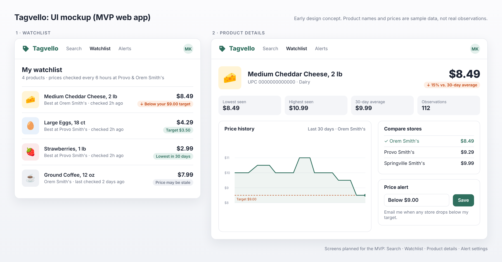
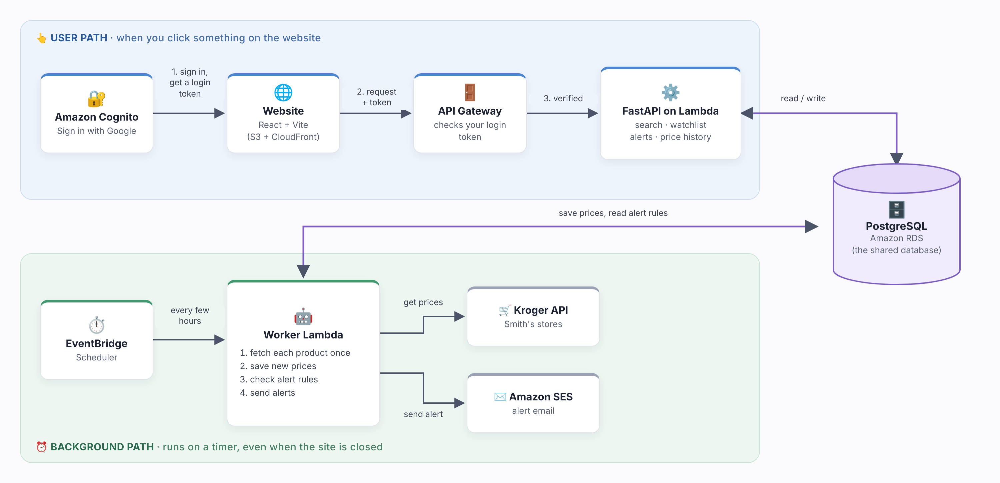
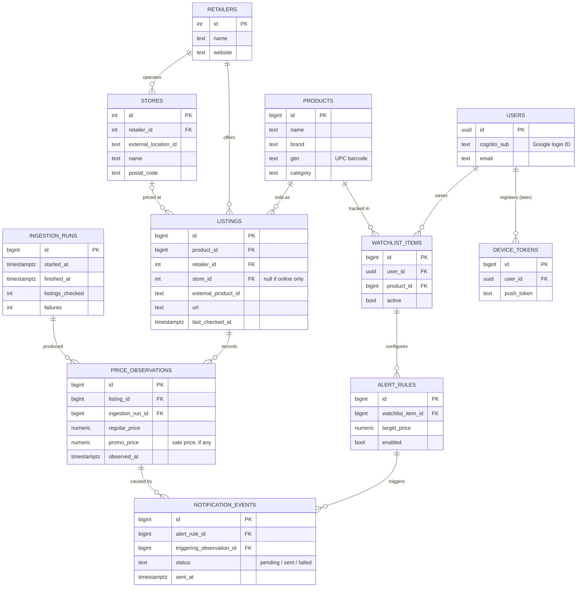

# Tagvello

**Find it once. Track it automatically. Buy it when the price is right.**

Tagvello is a web app that tracks the prices of products you want across different stores, records how those prices change over time, and emails you when a price drops below your target.


> 🚧 **Status:** Initial design. Final project for BYU C S 452 (Database Modeling Concepts). Progress and hours are tracked in [`PROJECT_LOG.md`](PROJECT_LOG.md).

---

## Contents

1. [Project Summary](#1-project-summary)
2. [System Design](#2-system-design)
3. [Database Design (ERD)](#3-database-design-erd)
4. [My Goals](#4-my-goals)
5. [Daily Plan](#5-daily-plan-nov-20--dec-10)
6. [Technical Details](#6-technical-details)

---

## 1. Project Summary

### Purpose

- **Make price tracking across stores easy.** Save a product once instead of checking several store websites.
- **Get notified of price drops.** An email arrives when a price falls below the target you set.
- **See if "on sale" is actually a good price.** Compare today's price to the lowest, highest, and average prices recorded over time.
- **Know which store has the best price** for the same product right now.

### UI mockup



*Early concept with sample data. Source: [`docs/mockup/mockup.html`](docs/mockup/mockup.html)*

### How it's different from other price trackers

| Most price trackers | Tagvello |
|---|---|
| Follow one online retailer (Keepa and camelcamelcamel track Amazon) | Tracks **individual physical stores**, so Provo Smith's and Orem Smith's are compared side by side |
| Focus on electronics and online goods | Starts with **groceries and household items** that people buy every week |
| Show the price the retailer advertises | Stores the **regular price and the promo price separately**, so a "sale" is checked against real history |
| Alert on one product at one retailer | **One alert watches every store** that carries the product |
| Keep their price history private | Builds **your own price dataset** that you can query and chart |

### MVP features

| Feature | What it does |
|---|---|
| 🔎 **Product search** | Search Smith's (Kroger) products by keyword and see the current price at nearby stores. |
| ⭐ **Watchlist** | Save the products you care about. Requires Google sign-in. |
| ⏰ **Automatic price checks** | A background job records the price of every watched product on a schedule, even when nobody has the site open. |
| 📈 **Price history** | A chart plus lowest, highest, and average prices, calculated with SQL from real recorded prices. |
| 🏪 **Store comparison** | The same product's price at each nearby store, cheapest first. |
| 🔔 **Price alerts** | Set a target price and get an email when any store drops below it. |

### Goals for the app

- **Automate product research.** Stop re-checking store websites by hand.
- **Find the best deal** across nearby stores without visiting each one.
- **Buy at the right time.** Know whether to buy now or wait, based on real price history.
- **Save money on everyday purchases** by catching drops on groceries and household items.
- **Build a personal price dataset** that becomes more useful the longer it runs.

---

## 2. System Design

Tagvello has **two paths that share one database**:

- **User path:** what happens when you click something on the website.
- **Background path:** what runs on a timer to collect prices and send alerts, even when the site is closed.

Alert emails link back to the product's page on the website, which connects the two paths for the user.



*Diagram source: [`docs/mockup/system-design.html`](docs/mockup/system-design.html)*

### Technologies at a glance

| Part | Technology | Role |
|---|---|---|
| Website | React + Vite, Recharts | Pages, forms, and price charts |
| Sign-in | Amazon Cognito (OAuth 2.0 with Google) | Lets users log in with their Google account |
| API | Python + FastAPI on AWS Lambda, behind API Gateway | Handles every request from the website |
| Database | PostgreSQL on Amazon RDS | Stores products, prices, watchlists, and alerts |
| Background job | EventBridge Scheduler + a worker Lambda | Collects prices and checks alerts on a timer |
| Price data | Kroger Public API (Smith's stores in Utah) | Real store-by-store prices |
| Email | Amazon SES | Sends price-drop alerts |
| Infrastructure | AWS SAM | Defines all the AWS resources in one file |

---

## 3. Database Design (ERD)

The database is built around one main idea: a **product** (what something *is*, like a 2 lb block of cheddar) is stored separately from a **listing** (*where* it's sold, like that cheddar at Orem Smith's). Prices are recorded on listings, so the same product can have a different price at every store.



### The tables in four groups

| Group | Tables | Question it answers |
|---|---|---|
| 🏪 **What is being sold** | `products`, `retailers`, `stores`, `listings` | What is it, and where can I buy it? |
| 💲 **Price data** | `price_observations`, `ingestion_runs` | What did it cost, and when did we check? |
| 👤 **Users and intent** | `users`, `watchlist_items`, `alert_rules` | Who wants what, and at what price? |
| 🔔 **Alert output** | `notification_events` | Who did we notify, and did the email send? |
| 📱 *Later* | `device_tokens` | Phone push notifications for a future mobile app |

### How the tables connect

*Example values are made up for illustration.*

| Relationship | Type | Example |
|---|---|---|
| Retailer → Stores | One to many | Smith's operates **Provo Smith's** and **Orem Smith's** |
| Product → Listings | One to many | *Tillamook Medium Cheddar* is sold at both stores, so it has **2 listings** |
| Store → Listings | One to many (optional) | Orem Smith's has thousands of listings. An online-only listing has **no store** |
| Listing → Price observations | One to many | Cheddar at Orem Smith's: $9.99 Monday, $9.99 Tuesday, **$8.49 Wednesday** |
| Ingestion run → Price observations | One to many | The 6:00 AM run saved 40 prices |
| Users ↔ Products (through watchlist items) | Many to many | Bob watches cheddar and eggs, and many users can watch cheddar |
| Watchlist item → Alert rules | One to many | "Email me when cheddar is under **$9.00**" |
| Alert rule → Notification events | One to many | One email for each price drop that meets the rule |
| Price observation → Notification events | One to many | The **$8.49** price is the one that triggered Bob's email |

### Example: following one price drop through the database

1. At 6:00 AM, an **ingestion run** checks cheddar at Orem Smith's and saves a new row in `price_observations`: **$8.49**.
2. The worker finds Bob's **alert rule** ("under $9.00"), which belongs to his **watchlist item** for cheddar.
3. It creates one `notification_events` row that links Bob's alert rule to the exact $8.49 price row, then sends the email.
4. If the job runs again, a unique rule on (alert rule, price row) stops a second email.

---

## 4. My Goals

### What I want to learn

- **Database design for time-based data.** Model prices that change over time, and write SQL that answers real questions: window functions, indexes, and `EXPLAIN ANALYZE`.
- **OAuth 2.0 from start to finish.** Google sign-in through Amazon Cognito, login tokens (JWTs), and protecting API routes.
- **Deploying on AWS.** Lambda, API Gateway, EventBridge, RDS, and SES, all defined as infrastructure as code with AWS SAM.
- **Reliable background jobs.** Scheduled work that handles retries and API rate limits, and never sends the same alert twice.
- **Working with a third-party API.** The Kroger API, including its OAuth client-credentials flow.

### What I want finished by December 10

- [ ] A deployed website where I can sign in with Google, search Smith's products, and add them to my watchlist
- [ ] A scheduled worker collecting real prices from at least 2 Smith's stores
- [ ] A price history chart and store comparison on each product's page
- [ ] An email alert when a price drops below my target
- [ ] A final report, a demo video, and 30–40 logged hours

---

## 5. Daily Plan (Nov 20 – Dec 10)

**Goal: 40 hours by December 10.** Fridays are the long work days (4 hours), and most other days are 2 hours. Sundays and Thanksgiving are off.

| Week | Mon | Tue | Wed | Thu | Fri | Sat | Hours | Milestone |
|---|---|---|---|---|---|---|---:|---|
| **Nov 16–21** | | | | ✅ Planning and initial design | Get a Kroger API key and test a price request; find Provo and Orem Smith's store IDs; Postgres in Docker; write the schema by hand **(4h)** | Alembic migrations; add the first retailer and store rows **(2h)** | 6 | Data access works |
| **Nov 23–28** | Kroger adapter: search products and get prices **(2h)** | Ingestion script saves prices for 10+ products at 2 stores. Run it daily from now on **(2h)** | SQL analytics: latest price, lows and averages with window functions; indexes and `EXPLAIN ANALYZE` **(2h)** | 🦃 Thanksgiving | FastAPI endpoints: search, watchlist, price history, store comparison, alert rules **(4h)** | pytest tests against a real Postgres **(2h)** | 12 | Backend works locally |
| **Nov 30–Dec 5** | AWS budget alert; Cognito user pool with Google sign-in **(2h)** | SAM template: RDS and the API Lambda; deploy and run migrations **(2h)** | EventBridge plus the worker Lambda: price checks run in the cloud **(2h)** | Alert checks without duplicates; SES email **(2h)** | React: Google login, search, watchlist, product page with chart and store comparison, alert settings **(4h)** | Host the site on S3 + CloudFront; test that a price drop sends an email **(2h)** | 14 | Full app runs on AWS |
| **Dec 7–10** | Polish: stale-data labels and error messages **(2h)** | Record a demo video; update the README and diagrams **(2h)** | Final report: what I learned, how I used AI, scaling, authentication, concurrency **(2h)** | Class channel post, final log, submit 🎉 **(1h)** | | | 7 | **Final project due Dec 10** |

**Planned: 39 hours from Nov 20 on, plus 3 hours logged through Nov 19 = 42 hours.**

---

## 6. Technical Details

<details>
<summary><b>Data sources</b></summary>

| Source | Status | Notes |
|---|---|---|
| **Kroger Public API** (Smith's in Utah) | 🟡 Validating | Free developer account using OAuth 2.0 client credentials. Prices are per store, with regular and promo prices. **Primary MVP source.** |
| **Best Buy Products API** | 🟡 Pending | Requires approval. No longer issues keys to Gmail- or Yahoo-type addresses. |
| **eBay / Amazon** | ⚪ Not in MVP | Access requirements don't fit the timeline. |

No unauthorized scraping. Every saved price records where it came from and when it was checked.
</details>

<details>
<summary><b>Engineering highlights</b></summary>

- **One request per listing.** If 100 users watch the same product, the worker fetches its price once per run, not 100 times.
- **No duplicate alerts.** A unique rule on (alert rule, triggering price) means a retried job can't send the same email twice.
- **SQL price analytics.** Window functions calculate price changes, lows, and averages inside the database.
- **Money stored as `NUMERIC`**, never floating point. All times are stored in UTC.
- **Fast latest-price lookups** using an index on (listing, observed time).
</details>

<details>
<summary><b>Keeping AWS costs low</b></summary>

- **No NAT gateway.** It would be the most expensive item for a project this size.
- **Pay-per-use services.** Lambda, API Gateway, EventBridge, and SES cost almost nothing at this scale. Cognito is free up to 10,000 monthly users.
- **The database is the main cost.** It runs on one small instance paid from AWS Free Tier credits.
- **An AWS Budget alert** is set up from day one.
</details>

<details>
<summary><b>Planned repository structure</b></summary>

```text
tagvello/
├── backend/
│   ├── app/          # FastAPI routes, models, Kroger adapter, alert logic
│   ├── worker/       # Scheduled price-collection job
│   ├── migrations/   # Alembic
│   ├── tests/
│   └── template.yaml # AWS SAM infrastructure
├── web/              # React + Vite website
├── docs/             # Project brief, mockups, images
├── PROJECT_LOG.md
└── README.md
```
</details>

<details>
<summary><b>After the class</b></summary>

- Alerts for a minimum percentage drop
- A mobile app (React Native + Expo) with push notifications, using the same API
- Best Buy as a second retailer
- Deal scores such as "lowest price in 30 days"
</details>

---

Built by **Madalyn Keyes Acevedo** · BYU Software Engineering · C S 452 Final Project
